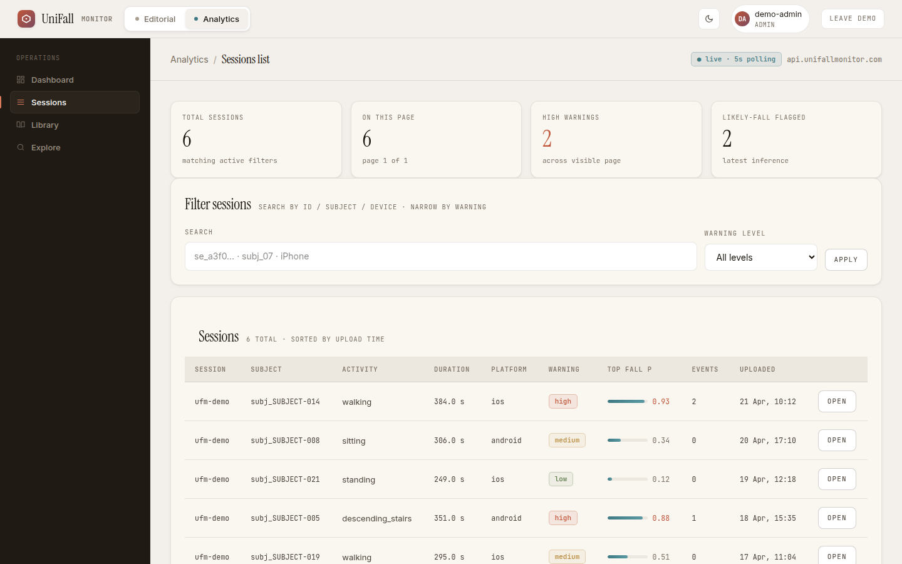
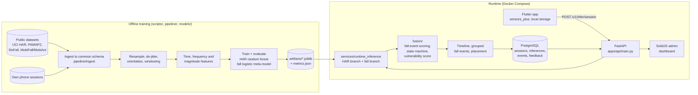

# UniFallMonitor: phone-based activity recognition and fall detection

The full system behind my final-year dissertation, UniFallMonitor. A phone in a pocket records accelerometer and gyroscope data. A Python service then works out what the person is doing (human activity recognition, HAR) and whether a fall is likely. Results are stored in PostgreSQL and reviewed in a web dashboard.

The repository covers the whole path:

- a **Flutter app** that records and uploads sensor sessions
- an **offline ML pipeline** that turns four public datasets into one schema, extracts window features and trains the HAR and fall models
- a **FastAPI runtime service** that runs both models on an uploaded session and stores the results
- a **SolidJS admin dashboard** for reviewing sessions and results
- Docker Compose deployment, database migrations, and a 328-test pytest suite

**How this relates to [uni-fall-monitor](https://github.com/joelshore4747/uni-fall-monitor):** the first 34 commits here are the same history as that repository, which holds the Flutter phone app. The 14 commits after it (1 May 2026) add everything else: the backend, the ML pipeline, the model artefacts, the admin dashboard, deployment and the tests. If you want the complete system, start here.


<sub>Admin dashboard in demo mode (`VITE_DEMO_MODE=true`). The sessions and subjects shown are synthetic sample data from `apps/admin/src/lib/demo.ts`.</sub>

## Architecture



**Inference for one uploaded session:**

1. The session is resampled and cut into overlapping windows. HAR and fall use different window sizes, and the windows are then lined up with each other.
2. **HAR branch:** a 200-tree random forest, calibrated with isotonic regression, over 107 window features (`artifacts/har/runtime_v1.joblib`). Labels: `walking`, `stairs`, `static`, `fall`, `other`. Predictions are smoothed with a rolling mean.
3. **Fall branch:** a staged threshold detector (impact, support, confirm) produces features such as peak acceleration, jerk and post-impact motion. A logistic-regression meta-model then gives a fall probability (`artifacts/fall/fall_meta_phone_negatives_v2`). This model was retrained with 145,632 rows of everyday phone movement (walking, stairs, sitting down, handling the phone) as hard negatives. Its alert threshold was raised from 0.5 to 0.75 to cut false alarms.
4. **Fusion:** per-window fall-event scoring, a monitoring state machine, and a vulnerability level per session.
5. The API returns a timeline, grouped fall events and a warning level, and persists them to PostgreSQL. It also accepts feedback and annotations, which feed retraining (`scripts/retrain_from_phone.py`).

The API includes health and readiness probes, admin login with session cookies and CSRF protection, optional HTTP Basic auth for the app (bcrypt-hashed accounts), JSON logging, and a request ID on every response.

## Results

**Tests:** I re-ran these on 29 October 2026 with Python 3.11 and scikit-learn 1.8.0, the version the artefacts were saved with.

| Setup | Result |
|---|---|
| `pytest tests/` with a PostgreSQL 16 container (`SCHEMA_TEST_DATABASE_URL`) | **318 passed, 10 skipped** |
| `pytest tests/` without a database | 304 passed, 24 skipped |

The 10 tests that still skip need a deployable runtime bundle or a SisFall validation run on disk. Neither is committed. One more test skips because its fixture no longer matches the stricter request schema. The suite covers:

- every dataset loader
- resampling and windowing
- feature extraction
- the threshold detector and threshold sweeps
- the state machine and vulnerability score
- runtime inference end to end
- the API's persistence and validation
- the database schema hardening

**Fall model on held-out subjects.** These are the committed metrics for the combined MobiFall + SisFall meta-model (`artifacts/fall/fall_meta_combined/metrics.json`). The split is a group shuffle by subject, with 29,134 test windows, at threshold 0.4:

| Sensitivity | Specificity | Precision | F1 | ROC-AUC |
|---|---|---|---|---|
| 0.881 | 0.351 | 0.337 | 0.487 | 0.711 |

The threshold favours catching falls over avoiding false alarms. A specificity of 0.35 means many false alerts on the public datasets. That is the main weakness this work exposed, and the reason the phone hard-negative retraining above exists.

**Dissertation figures.** These are committed under `apps/admin/public/figures/`. They were generated from result files in `results/`, which are git-ignored, so the numbers in them can't be re-derived from this repository alone.


The second figure shows that transferring HAR between datasets is asymmetric. Target-domain normalisation and CORAL help UCI HAR → PAMAP2 by about 0.06 macro-F1. The same methods hurt PAMAP2 → UCI HAR by 0.15 to 0.22.


## Running it

**Tests and API locally** (Python 3.11):

```bash
python3.11 -m venv .venv
source .venv/bin/activate
pip install -r requirements.txt -r requirements-dev.txt
pip install scikit-learn==1.8.0                  # match the pickled artefacts
pytest tests/ -q                                 # Postgres tests skip without a DB
cp .env.example .env                             # set DATABASE_URL
python scripts/db_init.py                        # apply db/migrations
./scripts/run_api.sh                             # http://localhost:8000
```

**Full stack with Docker Compose** (Postgres, migrations, API and the built admin UI):

```bash
cp .env.compose.example .env.compose             # set real secrets
docker compose --env-file .env.compose up --build
```

The API refuses to start if `ADMIN_SESSION_SECRET` is still the placeholder value. The Compose stack was not started during this review. Only the test suite above was run.

**Admin dashboard without a backend:**

```bash
cd apps/admin
npm ci
VITE_DEMO_MODE=true npm run dev
```

**Phone app:** `apps/mobile/app_mobile` (Flutter, `sensors_plus`). Point it at your API with `flutter run --dart-define=API_BASE_URL=http://<host>:8000` (see `lib/config/runtime_config.dart`).

**Training:** the training scripts expect the raw datasets under `data/raw/`, which are not committed. For example: `scripts/run_har_baseline.py`, `scripts/run_fall_artifact_train.py`, `scripts/run_har_domain_adaptation_eval.py` and `scripts/export_runtime_artifact.py`.

## Repository layout

```
apps/api/        FastAPI service (routes, auth, admin endpoints)
apps/admin/      SolidJS + TanStack admin dashboard
apps/mobile/     Flutter phone app
pipeline/        ingest, preprocessing, windowing, features, fall threshold detector
models/          HAR and fall training, inference and evaluation
fusion/          fall-event scoring, state machine, vulnerability score
services/        runtime inference, persistence, auth, logging, timelines
metrics/         classification and fall-event metrics
db/migrations/   PostgreSQL schema
scripts/         data prep, training, evaluation, export and debugging CLIs
tests/           pytest suite (fixtures are small synthetic CSVs)
artifacts/       trained model artefacts used by the runtime
```

## Data and licences

No raw dataset files are committed. `data/raw/` is git-ignored, and `tests/fixtures/` holds a few hand-written synthetic rows per dataset format. The committed model artefacts were trained on these datasets:

| Dataset | Used for | Licence / terms |
|---|---|---|
| [UCI HAR](https://archive.ics.uci.edu/dataset/240) (Anguita et al., 2013) | HAR | CC BY 4.0 |
| [PAMAP2](https://archive.ics.uci.edu/dataset/231) (Reiss and Stricker, 2012) | HAR | CC BY 4.0 |
| SisFall (Sucerquia et al., 2017) | Falls | Released for research. Cite the paper. No explicit open licence. |
| MobiFall / MobiAct (Vavoulas et al., BMI Lab) | Falls | Available on request for research use. Do not redistribute the raw data. |
| WISDM | HAR loader only | Check the release used: the 2019 UCI release is CC BY 4.0 |
| Own phone recordings | Hard negatives, runtime HAR | Collected by me. Not committed. |

## Limitations and next steps

- Specificity on public fall data is low (0.35 at the chosen threshold). Phone hard negatives help in practice, but a proper held-out phone test set with real falls is still missing.
- Fall-detection evidence comes from simulated falls in lab datasets plus my own recordings. It is not evidence of real-world performance with older adults.
- `ruff check .` currently reports 145 issues, so the CI lint step does not pass.
- `apps/mobile/app_mobile/app_mobile/` is a leftover second copy of the Flutter project and should be removed.

AI-assisted development: [Claude Code](https://claude.com/claude-code) was used to write this README, from the code and a fresh test run.
